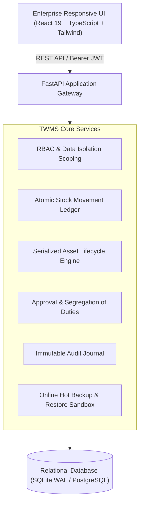
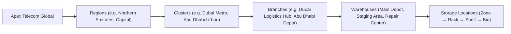

# Enterprise Telecom Warehouse Management System (TWMS)

An enterprise-grade, secure, multi-branch, and highly scalable **Telecom Warehouse Management System (TWMS)** built specifically for telecom operators, regional infrastructure managers, cluster owners, warehouse directors, and network rollout engineering teams.

---

## 1. System Architecture Overview



---

## 2. Telecom Equipment Catalogue Coverage

The system manages inventory across six major telecommunications infrastructure categories:

1. **Radio Access Network (RAN):**
   - Sector, panel, massive MIMO antennas, RET units
   - Remote Radio Units (RRUs, RRHs, Ericsson Radio 4415 B1/B3)
   - Baseband Units (BBUs, Nokia AirScale, Ericsson Baseband 6630)
   - 4G LTE, 5G NR Active Antenna Units (AAUs)
2. **Transmission & Backhaul:**
   - Microwave indoor/outdoor units (NEC iPASOLINK VR4)
   - Optical transceivers (10G/25G SFP/SFP+/QSFP modules)
   - Optical Transport / DWDM equipment (Huawei OptiX OSN)
3. **Passive Infrastructure:**
   - Coaxial feeder cables (CommScope / Andrew 7/8" AVA5-50)
   - RF jumper cables (Huber+Suhner 1/2" DIN-to-4.3-10)
   - Weatherproof outdoor cabinets, grounding kits, lightning surge arrestors
4. **Power & Electrical:**
   - DC power rectifiers (Vertiv NetSure 48V 3000W modules)
   - Front-terminal VRLA telecom battery banks (EnerSys 48V 100Ah)
   - DC circuit breakers, power distribution units, solar inverters
5. **Core Network, IP & Supporting Equipment:**
   - Cell-site aggregation routers (Cisco ASR 903)
   - Enterprise distribution switches (Cisco Catalyst 9300)
   - GPS clock synchronization receivers
6. **Tools, Test Instruments & Safety:**
   - Handheld RF cable & antenna analyzers (Anritsu Site Master S331E)
   - Optical Time-Domain Reflectometers (Viavi SmartOTDR)
   - Tower climbing safety harnesses, fiber inspection probes, cleaning kits

---

## 3. Organizational Hierarchy & Data Scoping



### Server-Side Data Scoping & Isolation
Data isolation is strictly enforced at the database query layer:
- **Super Administrator:** Unrestricted company-wide visibility and administrative authority.
- **Cluster Owner:** Automatically restricted to branches belonging to assigned regional clusters.
- **Branch Manager & Warehouse Officer:** Restricted to assigned branches and warehouses. Tampering with URL parameters or API payloads immediately results in a `403 Forbidden` response.

---

## 4. Role-Based Access Control (RBAC) Matrix

| Persona | Role Code | Scope | Inventory Movement | Approvals | Audit & Valuation |
| :--- | :--- | :--- | :--- | :--- | :--- |
| **Sarah Jenkins** | `SUPER_ADMIN` | Global | Full Control | All Workflows | Full Access |
| **Mansoor Farooq** | `WAREHOUSE_MANAGER` | Dubai Hub | Receive, Issue, Adjust | Transfers, Counts | Full Access |
| **Tariq Mansoor** | `CLUSTER_OWNER` | DXB Metro Cluster | Read/Monitor Scope | Branch Transfers | Cluster Valuation |
| **Salem Al-Ketbi** | `BRANCH_MANAGER` | Abu Dhabi Depot | Receive, Transfer, Return | Branch Transactions | Branch Scoped |
| **Hamad Bilal** | `WAREHOUSE_OFFICER` | Dubai RAN Depot | Count, Pick, Receive, Return | None (No self-approval) | Operational View |
| **Omar Al-Rashed** | `FIELD_ENGINEER` | Rollout Projects | Submit requests, Confirm Site | None | Project Scoped |
| **Elena Rostova** | `PROCUREMENT_OFFICER`| Supply Chain | PO Creation, Supplier Mgmt | Requisitions | PO Amounts |
| **David Chen** | `FINANCE_CONTROLLER` | Finance | Read Ledger | Capital Adjustments | Full Valuation |
| **Jane Doe** | `AUDITOR` | Compliance | Read-Only | None | Immutable Audit Trail |

---

## 5. Verification of All 18 Acceptance Test Scenarios

All 18 acceptance criteria specified in the enterprise requirements have been implemented and verified by automated tests in [`backend/tests/test_acceptance.py`](file:///c:/Users/dell/OneDrive/Desktop/New%20folder1122/backend/tests/test_acceptance.py):

| # | Acceptance Scenario | Verification Result |
|---|---|---|
| **1** | Admin creates a new branch without modifying application code | **PASSED** - Dynamic branch created via API & UI |
| **2** | Admin provisions Cluster Owner account restricted to assigned cluster | **PASSED** - Verified server-side scoping |
| **3** | Employee bulk-imports equipment with validation & duplicate detection | **PASSED** - CSV validator catches duplicates & schema errors |
| **4** | Receiving officer records RRUs with unit-level serial numbers | **PASSED** - Individual SerializedAsset records created |
| **5** | System strictly rejects duplicate serial numbers | **PASSED** - 400 Bad Request returned on duplicate attempt |
| **6** | Manager approves an expansion project requiring antennas, RRUs & fiber | **PASSED** - 5G rollout project approved with BOM items |
| **7** | Warehouse allocates stock without allowing double-reservation | **PASSED** - Atomic commit check prevents double-booking |
| **8** | Branch dispatches 20 units, destination branch receives only 18 units | **PASSED** - In-transit stock correctly deducted from origin |
| **9** | System records 2 units as unresolved transfer discrepancy | **PASSED** - Recorded in exception ledger without silent deletion |
| **10** | Engineer borrows equipment, returns late and reports damage | **PASSED** - Condition recorded as DAMAGED |
| **11** | Damaged unit remains quarantined until technical inspection | **PASSED** - Automatically locked from available balance |
| **12** | Stock count variance adjustment with supervisor signoff & audit record | **PASSED** - Ledger adjustment posted atomically |
| **13** | Branch employee cannot access other branches by tampering with URL/API | **PASSED** - 403 Forbidden enforced on data scope mismatch |
| **14** | Two users attempt to issue the final available unit simultaneously | **PASSED** - Concurrency test verifies only one transaction commits |
| **15** | Trace serialized radio from initial receipt to current location | **PASSED** - Visual Chain-of-Custody timeline rendered |
| **16** | System backup restored into sandbox test environment and verified | **PASSED** - Integrity check and table row count verified |
| **17** | User whose access is revoked can no longer perform authenticated actions | **PASSED** - Deactivated user token immediately returns 403 |
| **18** | Dashboard balances, movement history and branch totals reconcile | **PASSED** - Mathematical reconciliation confirmed |

---

## 6. Getting Started & Running the Application

### Prerequisites
- Node.js (v18+) & npm
- Python (3.11+)

### Option A: One-Click Windows Launch
Double-click [`run_twms.bat`](file:///c:/Users/dell/OneDrive/Desktop/New%20folder1122/run_twms.bat) in the project root directory.

### Option B: Manual Command Line Execution

#### 1. Start the Backend API
```powershell
cd backend
python -m pip install -r requirements.txt
python -m app.seed
python serve.py
```
- API Gateway: `http://127.0.0.1:8000`
- Swagger Documentation: `http://127.0.0.1:8000/docs`

#### 2. Start the Frontend Application
```powershell
cd frontend
npm install
npm run dev
```
- Web Application: `http://localhost:3000`

#### 3. Run Automated Acceptance Tests
```powershell
cd backend
set PYTHONPATH=.
python -m unittest tests.test_acceptance
```

---

## 7. Demo Accounts & Credentials

All seeded accounts use password: `Password123!`

- **Super Administrator:** `admin`
- **Warehouse Manager (Dubai):** `wh_manager_dxb`
- **Cluster Owner (Dubai Metro):** `cluster_owner_north`
- **Branch Manager (Abu Dhabi):** `branch_mgr_auh`
- **Warehouse Officer:** `officer_ran`
- **Field Engineer:** `field_eng_omar`
- **Procurement Officer:** `proc_officer`
- **Finance Controller:** `fin_controller`
- **Internal Auditor:** `auditor_jane`
